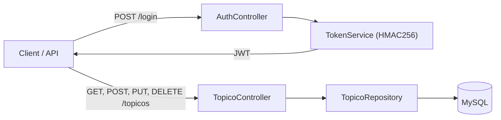

# Gilvam Oliveira

**Full Stack Developer**

Java · Spring Boot · Node.js · JavaScript · SQL

São Paulo, Brazil · Open to internships and junior roles (remote or hybrid)

[LinkedIn](https://www.linkedin.com/in/gilvam-oliveira) · [Email](mailto:oliveiragilvam70@gmail.com) · [GitHub](https://github.com/GilvamOliveira) · [Português](README.md)

---

## About

Full stack developer with a background in Information Technology Management. I build end-to-end applications — interfaces, APIs, data modeling and deployment — with a focus on readable code, tests and documentation.

I am looking for my first opportunity as a full stack developer, with a particular interest in back-end and data. I enjoy turning requirements into clear flows, recording decisions and making every project reproducible.

## Stack

| Area | Technologies |
| --- | --- |
| **Front-end** | HTML5 · CSS3 · JavaScript |
| **Back-end** | Java 17 · Spring Boot · REST APIs · Node.js · JWT · C# |
| **Data** | Python · Pandas · SQL · MySQL · PostgreSQL · SQLite · Streamlit · Plotly |
| **Tools** | Git · GitHub · GitHub Actions · Maven · npm · Docker · Figma · IntelliJ IDEA · VS Code |
| **Quality** | Automated tests · CI · technical documentation |

## Featured projects

Three projects that show what I can build end to end. Each one has a case study covering context, technical decisions, tests and next steps.

### Client CRUD

A CRUD exercise became a complete application: static front end, REST API and database. The same interface runs online with `localStorage` or locally with Node.js and SQLite.

- **Product:** search, filters, server-side pagination, dashboard, CSV/JSON export, bulk delete with undo and optional authentication.
- **Engineering:** validation on both sides, duplicate blocking, soft delete, security headers and rate limiting.
- **Quality:** 23 automated tests, ESLint, CI and a Docker image.

`Node.js` `SQLite` `JavaScript` `REST` `Docker`

[Demo](https://gilvamoliveira.github.io/CRUD/) · [Code](https://github.com/GilvamOliveira/CRUD) · [Case study](https://github.com/GilvamOliveira/CRUD/blob/main/CASE_STUDY.md)

### ForumHub

REST API for a forum with topic CRUD, duplicate validation, Flyway migrations and MySQL persistence. The login endpoint issues a JWT; credential and token validation are on the security roadmap.

- **Domain:** topics with title, message, author, course, status and creation date.
- **Architecture:** controllers, DTOs, JPA repository and versioned migrations.
- **Quality:** context test and environment configuration for the database and JWT secret.

`Java` `Spring Boot` `JPA` `JWT` `MySQL` `Flyway`

[Code](https://github.com/GilvamOliveira/forumhub) · [Case study](https://github.com/GilvamOliveira/forumhub/blob/master/CASE_STUDY.md)

### Meteoro de Lógica

Platform to browse and run 84 logic exercises from the Manzano and Faccat workbooks, with VisualG and JavaScript solutions in the browser.

- **Product:** catalog by workbook and page, editor, interactive terminal and local persistence.
- **Engineering:** custom VisualG interpreter and JavaScript execution in a Web Worker with time and output limits.
- **Quality:** 23 automated tests and CI on every push.

`JavaScript` `Web Worker` `VisualG` `HTML/CSS` `GitHub Actions`

[Demo](https://gilvamoliveira.github.io/VisualG-JavaScript-Logic-Exercises-PROA/) · [Code](https://github.com/GilvamOliveira/VisualG-JavaScript-Logic-Exercises-PROA) · [Case study](https://github.com/GilvamOliveira/VisualG-JavaScript-Logic-Exercises-PROA/blob/main/CASE_STUDY.md)

## Other projects

- **[Salary Dashboard](https://github.com/GilvamOliveira/Dashboard-Salarios-Area-de-Dados)** — exploratory analysis of data-field salaries with Python, Pandas, Streamlit and Plotly.
- **[LiterAlura](https://github.com/GilvamOliveira/LiterAlura)** — book catalog that consumes the Gutendex API and persists data with Java, JPA and PostgreSQL.
- **[CambioDeMoedas](https://github.com/GilvamOliveira/CambioDeMoedas)** — currency converter with an exchange-rate API and credentials via environment variable.
- **[Design Portfolio](https://github.com/GilvamOliveira/design-portfolio)** — 8 interface projects and Figma prototypes.

## How I work

- I start with the problem and the flows; only then do I choose the stack.
- I leave a README, environment variables and reproducible run instructions.
- I test what can be tested and automate verification with CI.
- I document decisions and known limits instead of hiding technical debt.

## Education

- **Technologist Degree in Information Technology Management** — Universidade Cruzeiro do Sul (2024)
- **Oracle Next Education (ONE) / Alura** — Java, Spring Boot and REST APIs (completed)
- **Instituto PROA** — software development with C#, front-end and databases (in progress)

## Contact

[LinkedIn](https://www.linkedin.com/in/gilvam-oliveira) · [Email](mailto:oliveiragilvam70@gmail.com) · [GitHub](https://github.com/GilvamOliveira)

For proposals and conversations about back-end, data and full stack development, reach me on LinkedIn or by email.
