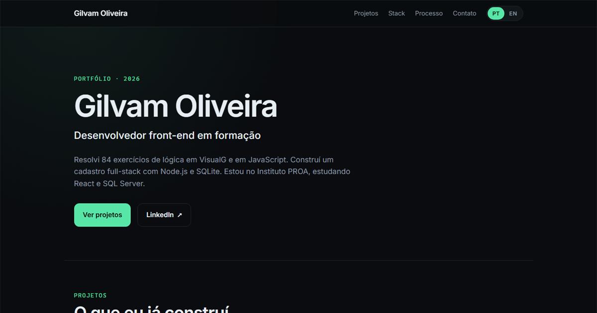

# Gilvam Oliveira

**Desenvolvedor back-end em formação**

Java · Spring Boot · Node.js · APIs REST · SQL · iniciando C#/.NET

São Paulo — remoto ou híbrido · aberto a estágio e posições júnior

[English](README.en.md)

---

Site em React + Vite, bilíngue (PT-BR/EN-US) e com foco em acessibilidade. [Abrir portfólio →](https://gilvam.is-a.dev) · [Código →](https://github.com/GilvamOliveira/portfolio)

## Sobre

Desenvolvo APIs e as aplicações que consomem essas APIs. No back-end trabalho com Java, Spring Boot, Node.js e SQL; no front-end, com HTML, CSS, JavaScript e React.

Meu objetivo é atuar como desenvolvedor back-end em C#/.NET. Começo o módulo de C# do Instituto PROA e os projetos dessa stack entram aqui conforme o curso avança. Até agora, o back-end que está publicado é em Java e Node.js.

Antes do PROA, concluí o Oracle Next Education (ONE), onde fiz os projetos de Java e Spring Boot que aparecem abaixo.

## Stack

**Back-end:** Java 17 · Spring Boot · Spring Data JPA · Node.js · APIs REST

**Dados:** SQL · MySQL · PostgreSQL · SQL Server · SQLite · Flyway

**Qualidade:** JUnit · `node:test` · GitHub Actions · ESLint · Prettier · Docker

**Front-end:** HTML5 · CSS3 · JavaScript (ES6+) · React · Vite

**Ferramentas:** Git · GitHub · Maven · Figma

**Próximo passo:** C#/.NET no Instituto PROA

## Projetos em destaque

### ForumHub — API REST de fórum

API de tópicos de fórum com Java 17, Spring Boot, Spring Data JPA, MySQL e Flyway. Tem DTOs, validação, migrations e cadastro que recusa título e mensagem duplicados. O login emite um JWT; a validação desse token nas requisições ainda está em implementação e isso está registrado no README.

**Meu papel:** desafio do ONE — modelagem, endpoints, migrations e configuração por ambiente.

`Java` `Spring Boot` `JPA` `MySQL` `JWT` · [Código](https://github.com/GilvamOliveira/forumhub)

### Cadastro de Clientes — API + interface

Cadastro de clientes com API REST em Node.js e SQLite, paginação, busca, filtros e ordenação feitos no servidor. A autenticação por token é opcional, há rate limiting por rota, CORS restrito e 23 testes automatizados rodando no CI. A mesma interface funciona sem back-end, com fallback para `localStorage` na demo estática.

**Meu papel:** construí a base a partir do projeto do curso e evoluí a API, os testes e a configuração de deploy.

`JavaScript` `Node.js` `SQLite` `REST` `Docker` · [Demo](https://gilvamoliveira.github.io/client-registry/) · [Código](https://github.com/GilvamOliveira/client-registry)

### LiterAlura — catálogo de livros

Catálogo que consulta a API Gutendex e salva livros e autores com JPA e PostgreSQL, permitindo buscar por título, listar autores e filtrar por idioma.

**Meu papel:** implementação do desafio do ONE.

`Java` `Spring Boot` `JPA` `PostgreSQL` · [Código](https://github.com/GilvamOliveira/LiterAlura)

### Meteoro de Lógica

Plataforma de estudo com os 84 exercícios das apostilas Manzano e Faccat. As soluções aparecem em VisualG e JavaScript lado a lado, e um interpretador de VisualG escrito em JavaScript executa os programas direto no navegador. Tem 23 testes e CI.

**Meu papel:** resolvi os 84 exercícios nas duas linguagens; a interface foi construída com apoio de IA.

`JavaScript` `VisualG` `HTML` `CSS` · [Demo](https://gilvamoliveira.github.io/meteoro-de-logica/) · [Código](https://github.com/GilvamOliveira/meteoro-de-logica)

[Ver os projetos no portfólio →](https://gilvam.is-a.dev)

## Design

Oito protótipos de UI no Figma: login, landing pages, app mobile e uma página educativa. [Ver portfólio de design →](https://github.com/GilvamOliveira/design-portfolio)

## Formação

- **Instituto PROA** — formação em desenvolvimento com front-end, C# e banco de dados (em andamento)
- **Oracle Next Education (ONE)** — equipe G9, Java, Spring Boot e APIs REST (concluído em julho de 2026)
- **Tecnólogo em Gestão da Tecnologia da Informação** — Universidade Cruzeiro do Sul (2024)

## Certificações

- **Oracle Cloud Infrastructure (OCI) Foundations Associate** — Oracle (2026)

## Contato

Aberto a estágio e posições júnior em back-end, remoto ou híbrido em São Paulo.

[LinkedIn](https://www.linkedin.com/in/gilvam-oliveira) · [E-mail](mailto:oliveiragilvam70@gmail.com) · [Portfólio](https://gilvam.is-a.dev)
