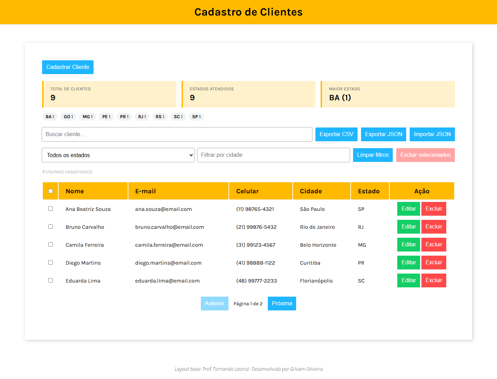
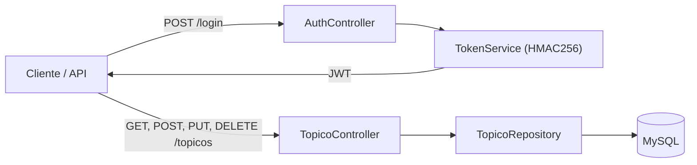
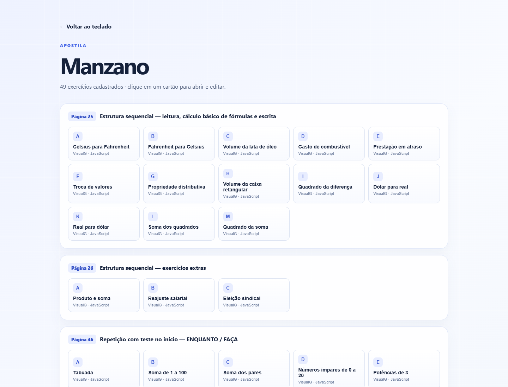

# Gilvam Oliveira

**Desenvolvedor Full Stack**

Java · Spring Boot · Node.js · JavaScript · SQL

São Paulo, SP · Aberto a estágio e posições júnior (remoto ou híbrido)

[LinkedIn](https://www.linkedin.com/in/gilvam-oliveira) · [E-mail](mailto:oliveiragilvam70@gmail.com) · [GitHub](https://github.com/GilvamOliveira) · [English](README.en.md)

---

## Sobre

Desenvolvedor full stack com base em Gestão da Tecnologia da Informação. Construo aplicações de ponta a ponta — interfaces, APIs, modelagem de dados e deploy — com foco em código legível, testes e documentação.

Busco minha primeira oportunidade como desenvolvedor full stack, com interesse especial em back-end e dados. Gosto de transformar requisitos em fluxos claros, registrar decisões e deixar cada projeto reproduzível.

## Stack

| Área | Tecnologias |
| --- | --- |
| **Front-end** | HTML5 · CSS3 · JavaScript |
| **Back-end** | Java 17 · Spring Boot · APIs REST · Node.js · JWT · C# |
| **Dados** | Python · Pandas · SQL · MySQL · PostgreSQL · SQLite · Streamlit · Plotly |
| **Ferramentas** | Git · GitHub · GitHub Actions · Maven · npm · Docker · Figma · IntelliJ IDEA · VS Code |
| **Qualidade** | Testes automatizados · CI · documentação técnica |

## Projetos em destaque

Três projetos que mostram o que sei fazer de ponta a ponta. Cada um tem um estudo de caso com contexto, decisões técnicas, testes e próximos passos.

### CRUD de Clientes

Um CRUD deixou de ser exercício de formulário e virou uma aplicação completa: front-end estático, API REST e banco de dados. A mesma interface funciona online com `localStorage` ou localmente com Node.js e SQLite.

- **Produto:** busca, filtros, paginação no servidor, dashboard, exportação CSV/JSON, exclusão em lote com desfazer e autenticação opcional.
- **Engenharia:** validação nos dois lados, bloqueio de duplicidade, soft delete, headers de segurança e rate limiting.
- **Qualidade:** 23 testes automatizados, ESLint, CI e imagem Docker.

`Node.js` `SQLite` `JavaScript` `REST` `Docker`

[Demo](https://gilvamoliveira.github.io/CRUD/) · [Código](https://github.com/GilvamOliveira/CRUD) · [Estudo de caso](https://github.com/GilvamOliveira/CRUD/blob/main/CASE_STUDY.md)

### ForumHub

API REST para um fórum, com CRUD de tópicos, validação de duplicidade, migração Flyway e persistência em MySQL. O endpoint de login emite um JWT; a validação de credenciais e do token está no roadmap de segurança.

- **Domínio:** tópicos com título, mensagem, autor, curso, status e data de criação.
- **Arquitetura:** controllers, DTOs, repository JPA e migrations versionadas.
- **Qualidade:** teste de contexto e configuração de ambiente para banco e segredo JWT.

`Java` `Spring Boot` `JPA` `JWT` `MySQL` `Flyway`

[Código](https://github.com/GilvamOliveira/forumhub) · [Estudo de caso](https://github.com/GilvamOliveira/forumhub/blob/master/CASE_STUDY.md)

### Meteoro de Lógica

Plataforma para consultar e executar 84 exercícios de lógica das apostilas Manzano e Faccat, com soluções em VisualG e JavaScript no navegador.

- **Produto:** catálogo por apostila e página, editor, terminal interativo e persistência local.
- **Engenharia:** interpretador VisualG próprio e execução de JavaScript em Web Worker com limites de tempo e saída.
- **Qualidade:** 23 testes automatizados e CI em cada push.

`JavaScript` `Web Worker` `VisualG` `HTML/CSS` `GitHub Actions`

[Demo](https://gilvamoliveira.github.io/VisualG-JavaScript-Logic-Exercises-PROA/) · [Código](https://github.com/GilvamOliveira/VisualG-JavaScript-Logic-Exercises-PROA) · [Estudo de caso](https://github.com/GilvamOliveira/VisualG-JavaScript-Logic-Exercises-PROA/blob/main/CASE_STUDY.md)

## Outros projetos

- **[Dashboard de Salários](https://github.com/GilvamOliveira/Dashboard-Salarios-Area-de-Dados)** — análise exploratória de salários na área de dados com Python, Pandas, Streamlit e Plotly.
- **[LiterAlura](https://github.com/GilvamOliveira/LiterAlura)** — catálogo de livros que consome a API Gutendex e persiste dados com Java, JPA e PostgreSQL.
- **[CambioDeMoedas](https://github.com/GilvamOliveira/CambioDeMoedas)** — conversor de moedas com API de câmbio e credenciais via variável de ambiente.
- **[Portfólio de Design](https://github.com/GilvamOliveira/design-portfolio)** — 8 projetos de interface e protótipos no Figma.

## Como trabalho

- Começo pelo problema e pelos fluxos; só então escolho a stack.
- Deixo README, variáveis de ambiente e instruções de execução reproduzíveis.
- Testo o que dá para testar e automatizo a verificação com CI.
- Documento decisões e limites conhecidos, em vez de esconder dívida técnica.

## Formação

- **Tecnólogo em Gestão da Tecnologia da Informação** — Universidade Cruzeiro do Sul (2024)
- **Oracle Next Education (ONE) / Alura** — Java, Spring Boot e APIs REST (concluído)
- **Instituto PROA** — desenvolvimento com C#, front-end e banco de dados (em andamento)

## Contato

[LinkedIn](https://www.linkedin.com/in/gilvam-oliveira) · [E-mail](mailto:oliveiragilvam70@gmail.com) · [GitHub](https://github.com/GilvamOliveira)

Para propostas e conversas sobre back-end, dados e desenvolvimento full stack, envie uma mensagem pelo LinkedIn ou e-mail.
